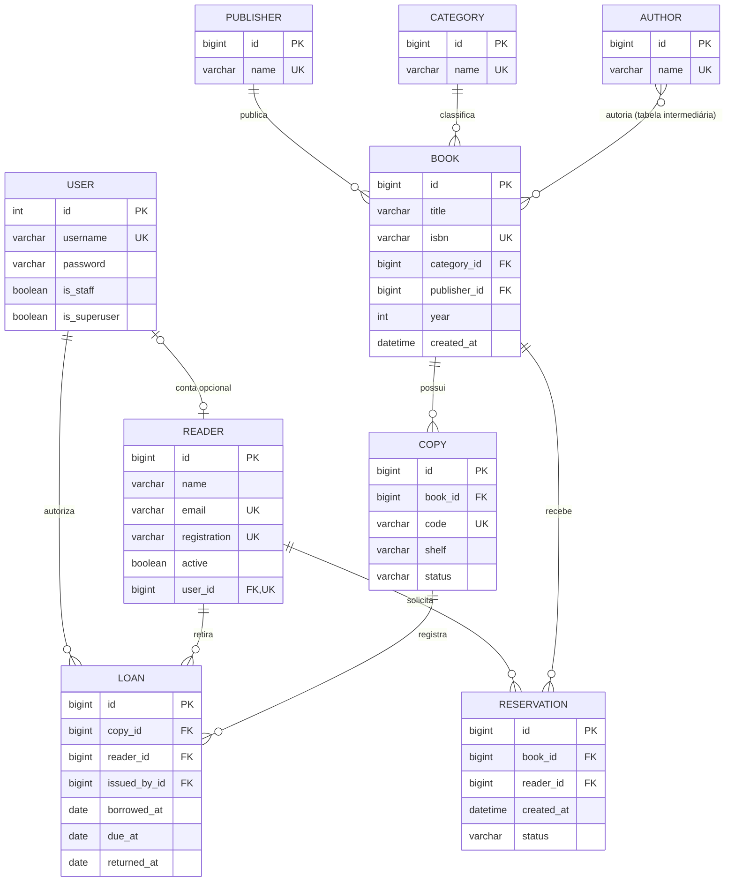

# Modelagem relacional · Fólio

O domínio é dividido em catálogo bibliográfico e circulação. Livro representa a obra/edição; Exemplar representa cada unidade física. Assim, uma obra pode ter diversos empréstimos simultâneos, desde que de exemplares diferentes.

## Dicionário

Todas as entidades de domínio possuem `id` como chave primária BigAutoField. O usuário é `auth.User` nativo do Django. Os campos são obrigatórios, salvo indicação de nulidade.

| Entidade | Campos | Relacionamentos / regras |
| --- | --- | --- |
| Autor | name varchar(150), único | N:N Livro via tabela automática `catalog_book_authors`; par livro/autor único |
| Categoria | name varchar(100), único | 1:N Livro; exclusão protegida quando vinculada |
| Editora | name varchar(150), único | 1:N Livro; exclusão protegida quando vinculada |
| Livro | title varchar(200), isbn varchar(13) único, year inteiro positivo, created_at datetime | N:1 Categoria, N:1 Editora, N:N Autor; ano entre 1450 e 2100 |
| Exemplar | code varchar(30) único, shelf varchar(60), status varchar(15) | N:1 Livro; status disponível, manutenção ou extraviado |
| Leitor | name varchar(150), email varchar(254) único, registration varchar(30) única, active boolean | user_id opcional, OneToOne, SET_NULL; empréstimos/reservas históricos protegidos |
| Empréstimo | borrowed_at date, due_at date, returned_at date opcional | N:1 Exemplar, N:1 Leitor, N:1 Usuário responsável; todos PROTECT |
| Reserva | created_at datetime, status varchar(15) | N:1 Livro, N:1 Leitor; ambos PROTECT; aguardando, atendida ou cancelada |

## Regras e normalização

1. Autor, categoria e editora ficam em tabelas próprias para evitar redundância. Livro e autor têm tabela associativa. O domínio está organizado em terceira forma normal.
2. Uma restrição única parcial impede dois empréstimos com `returned_at IS NULL` para o mesmo exemplar. A disponibilidade exibida é derivada de condição física e ausência de empréstimo ativo; não há um segundo campo de empréstimo para ficar desatualizado.
3. `due_at >= borrowed_at` e `returned_at IS NULL OR returned_at >= borrowed_at` são CHECKs no banco.
4. Apenas uma reserva `waiting` por par livro/leitor; reservas históricas são preservadas.
5. Leitor inativo e exemplar em manutenção/extraviado não podem originar novos empréstimos. A validação ocorre no model e na API; escrita SQL direta deve respeitar também as regras da aplicação.
6. API usa transação no empréstimo, devolução e operações de livro. A unicidade no banco protege contra duplicação concorrente; um conflito resulta em mensagem de erro. SQLite é adequado à apresentação local e não oferece o mesmo bloqueio por linha do PostgreSQL.
7. Chaves estrangeiras PROTECT preservam o histórico. A API só exclui livros sem empréstimos nem reservas, removendo seus exemplares na mesma transação. No admin, remover primeiro os exemplares sem histórico.
8. O prazo é armazenado como data e comparado à data local `America/Sao_Paulo`. Atraso é calculado, não persistido.

## Tabelas de infraestrutura

Além das oito entidades, Django mantém usuário, grupos, permissões, associações usuário/grupo e grupo/permissão, sessões, histórico do admin, tipos de conteúdo e migrações. A relação opcional Usuário–Leitor é 0..1 para 0..1; um administrador não precisa ser leitor.

## Filtros para demonstrar

| Administração | Filtros |
| --- | --- |
| Livros | Categoria, editora, ano e autores |
| Exemplares | Condição física, categoria do livro e prateleira |
| Leitores | Ativo/inativo |
| Empréstimos | Situação calculada (aberto/atrasado/devolvido), retirada, prazo e categoria |
| Reservas | Situação, data e categoria |

As listagens também têm busca textual; livros e empréstimos possuem navegação hierárquica por data. O filtro de empréstimos está implementado em `LoanStatusFilter`.
